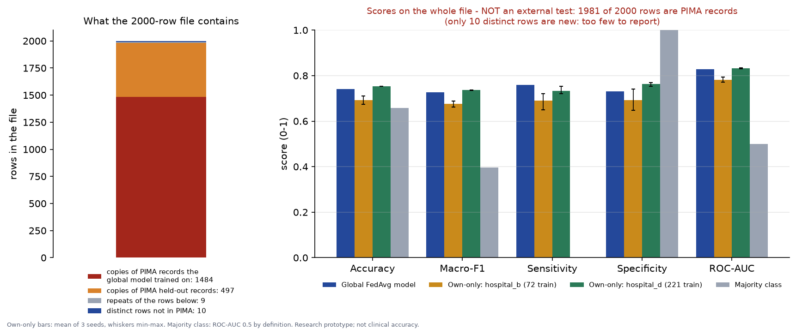

# External validation of the global diabetes model

**The question:** does the FedAvg global diabetes model work on patients from a hospital that never took part in
training?

**The answer from this attempt:** it can't be answered with the "Frankfurt Hospital" diabetes file. **1,981 of its
2,000 rows are records of the PIMA dataset the model was trained on.** Only 10 distinct rows are new, which is far
too few to measure anything. A real external test needs a different, independent cohort (see
[What would make a real external test](#what-would-make-a-real-external-test)).

Research prototype, not a medical device. None of the numbers here are clinical accuracy.

## The dataset

| | |
|---|---|
| Name | "Diabetes dataset, Frankfurt Hospital, Germany" (2,000 people; described on [IEEE DataPort](https://ieee-dataport.org/documents/type-2-diabetes-dataset) as 684 diabetic, published on Kaggle) |
| Copy used | `https://raw.githubusercontent.com/nguyentho1/ft-transformer-diabetes/HEAD/data/raw/frankfurt_diabetes.csv` |
| Same bytes also at | `https://raw.githubusercontent.com/sajjadaghasijavid/Evaluating-Ensemble-Learning-Diabetes/HEAD/data/2.%20frankfurt_diabetes.csv` and `https://raw.githubusercontent.com/ibrahimuhammad/diabetes_prediction/HEAD/diabetes.csv` |
| MD5 | `5304944c7c2939f27f1c0ef95bad0cca` (identical in all three) |
| Shape | 2,000 rows; columns `Pregnancies, Glucose, BloodPressure, SkinThickness, Insulin, BMI, DiabetesPedigreeFunction, Age, Outcome` |
| Outcome | 0/1; 1,316 no diabetes, 684 diabetes, matching the published description |
| Where | `data/external/frankfurt_diabetes.csv`, git-ignored. Download it yourself and check the MD5. |

The copy isn't modified. Three independent repositories hold byte-identical files, and the size and class
balance match the published description. The problem below is in the dataset itself.

## Method

`scripts/evaluate_external.py --modality diabetes --csv data/external/frankfurt_diabetes.csv --label Outcome`

1. **Model.** It loads the global model the way the agent's prediction does: `global_latest.npz` plus its
   `.json`, with the SHA-256 checked against the JSON and the architecture signature checked against the code.
   The model used is the MLP **v8** (`diabetes-r0008`, SHA-256 `b882baa8…`) that the source agent kept after the
   8 diabetes rounds of the predict-feature test. Every hospital in those rounds trained on PIMA records.
2. **Column matching.** `ml/common/column_mapping.py` matched all 8 inputs by name. No unit conversion was needed
   (glucose is already in mg/dL). Zeros in glucose, blood pressure, skin fold, insulin and BMI are treated as
   "not measured".
3. **Preprocessing,** as in training: KNN imputation (`EHRImputer`) for the gaps, then the fixed reference
   standardisation in `ml/diabetes/features.py`. The imputer is fitted on the evaluated records' measurements,
   never their outcomes.
4. **Threshold** 0.5. Reported: n, class balance, accuracy, macro-F1, sensitivity, specificity, ROC-AUC, the
   confusion matrix, and 95% bootstrap intervals for the global model.
5. **Baselines on the same rows:**
   - **(a) Own-only models:** a model trained only on **one** PIMA hospital's training split. Both the smallest
     (hospital_b, 72 training records) and the largest (hospital_d, 221) were trained, each for 8 rounds × 2
     local epochs (the same as the global model's rounds), with 3 seeds.
   - **(b) Majority class:** always "no diabetes", the training data's majority.

## The overlap check

Every Frankfurt row was compared with the 768 PIMA records (OpenML 37, MD5 `3cbaa3e5…`). A row counts as a match
when all 8 measurements are equal, with "not measured" counted the same way in both files.

| | Rows |
|---|---|
| Rows that equal a PIMA record | **1,981 of 2,000** (734 of PIMA's 768 records, every one with the same outcome) |
| … copies of records in the hospitals' **training** splits (the model learned from them) | 1,484 |
| … copies of PIMA records held out from training | 497 |
| Exact repeated rows in the file | 1,256 |
| Rows not in PIMA | 19 |
| **Distinct rows not in PIMA** | **10** (4 diabetes, 6 not); each shares at most 2-4 of its 8 values with any PIMA record |

All 1,981 matching rows are excluded. Including them would inflate the score: the model would be "tested" on
records it trained on.

The first version of this check compared Frankfurt's raw zeros with PIMA's "not measured" gaps. That missed most
of the copies and found only 1,025. It was corrected before any result was written down; both files now go
through the same zero-to-gap rule.

## Results

| Set | n (yes / no) | Model | Accuracy | Macro-F1 | Sensitivity | Specificity | ROC-AUC |
|---|---|---|---|---|---|---|---|
| **Not in PIMA, distinct** | 10 (4 / 6) | Global FedAvg | 0.400 | 0.375 | 0.750 | 0.167 | 0.292 |
| | | Own-only, smallest (b), 3 seeds | 0.500 | 0.465 | 0.917 | 0.222 | 0.500 |
| | | Own-only, largest (d), 3 seeds | 0.600 | 0.577 | 1.000 | 0.333 | 0.500 |
| | | Majority class | 0.600 | 0.375 | 0.000 | 1.000 | 0.500 |
| Whole file, **NOT external** | 2,000 (684 / 1,316) | Global FedAvg | 0.740 | 0.727 | 0.759 | 0.730 | 0.828 |
| | | Own-only, smallest (b), 3 seeds | 0.692 | 0.676 | 0.691 | 0.692 | 0.782 |
| | | Own-only, largest (d), 3 seeds | 0.753 | 0.736 | 0.732 | 0.763 | 0.832 |
| | | Majority class | 0.658 | 0.397 | 0.000 | 1.000 | 0.500 |

- **Global model confusion matrices:**
  - 10-row set: TN 1, FP 5, FN 1, TP 3.
  - Whole file: TN 961, FP 355, FN 165, TP 519.
- **95% bootstrap intervals, global model on the 10 rows:** accuracy 0.10-0.70, ROC-AUC 0.00-0.67. The intervals
  are so wide that the 10-row numbers say nothing.
- **Seed spread:** own-only values are the mean of 3 seeds. On the whole file, the spread across seeds is at most
  0.10 for any metric (hospital_b specificity 0.648-0.742).
- **Full output:** the full numbers are in `docs/results/external_diabetes.json`; the chart is
  `docs/results/external_diabetes.png`.



## What it shows, in plain words

- **No external-validation claim can be made from this file.** It is the PIMA data again: 734 of PIMA's 768
  patients, repeated to 2,000 rows. Ten new rows can't tell a good model from a coin toss.
- **The whole-file score (accuracy 0.74, ROC-AUC 0.83) is not evidence of generalisation.** 1,484 of those rows
  are records the model trained on. It is close to the model's normal PIMA held-out score; it isn't a test on
  new people.
- **Even on this contaminated file, the global model doesn't beat every single hospital.**
  - It is better than the smallest hospital's own model (macro-F1 0.727 vs 0.676) and far better than always
    saying "no" (0.397).
  - The largest hospital's own model scores about the same or slightly higher (0.736).
  - This agrees with `docs/global_vs_local.md`. On real PIMA data, the global model's gain is clearest for small
    hospitals.
- **The pipeline itself works end to end:**
  - A file with its own headings is matched, cleaned, imputed, scored and compared.
  - Copies of training records are found and removed.
  - The same code runs in the agent's "Evaluate with labelled file" window, which tests the model on a
    hospital's own records on its own computer.

## Honest limits

- **One saved model, one population.** All the training records are PIMA: Pima women aged 21 and over in
  Arizona, collected decades ago. A real German hospital cohort would differ in ethnicity, sex, age, how glucose
  was measured, and how diabetes was defined. A drop in score would be expected there, and it would need to be
  reported as it is.
- **The "Frankfurt" origin can't be verified from the file.** Whatever its history, its content is PIMA records,
  so it can't stand in for a different population.
- **Imputation uses the evaluated file's own measurements.** This is what a new hospital without training
  records would do. The outcomes are never used. Imputing from the training hospitals' records instead could
  change the scores slightly.
- **Threshold 0.5, chosen in advance.** It isn't tuned on this file.
- **No calibration or subgroup analysis,** and no clinical interpretation. This is a research prototype.

## What would make a real external test

A labelled cohort with the same 8 measurements (or most of them, since the matching handles gaps and other
headings) that is **not derived from PIMA**. The script works unchanged on any such file:

```
python scripts/evaluate_external.py --modality diabetes --csv <file> --label <outcome column> [--positive <yes values>]
```

It always runs the overlap check against PIMA first. If a file turns out to be PIMA again, the result will say so
instead of reporting a score.

The agent offers the same test to a hospital on its own past patients: **Evaluate with labelled file…** (agent
1.1.1). For example, the test hospital's 75 held-out records gave accuracy 0.747, macro-F1 0.744, sensitivity
0.750, specificity 0.744 and ROC-AUC 0.818. Those records come from the same (PIMA) cohort, so this is an
internal check, not an external one.
